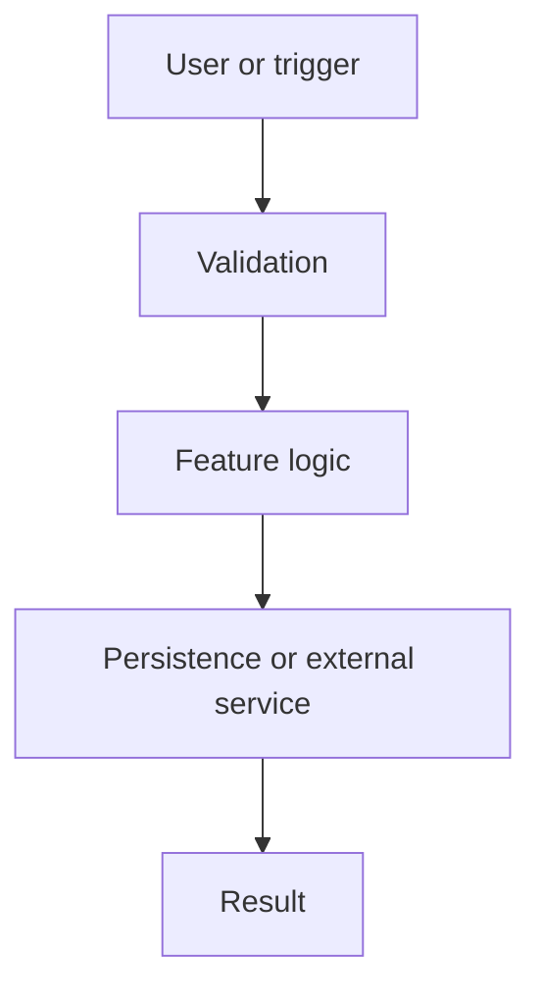

# Architecture: <Feature Name>

## Context and Current State

<Describe verified existing architecture and relevant source paths. Separate facts from assumptions.>

## Proposed Design

<Explain the design and why it fits the existing codebase.>

## Components and Responsibilities

| Component | Status | Responsibility | Relevant path |
|---|---|---|---|
| <Component> | Existing/Proposed | <Responsibility> | `<path>` |

## Data Flow

1. <Trigger or input>
2. <Validation and processing>
3. <Persistence or external interaction>
4. <Response and side effects>

Replace the example diagram with a codebase-specific diagram, or remove it if it would be speculative.

## API and Contracts

### <Endpoint, function, event, or interface>
- **Purpose:** <Purpose>
- **Input:** <Schema or types>
- **Output:** <Schema or types>
- **Errors:** <Error cases>
- **Authorization:** <Required access>
- **Idempotency/pagination/versioning:** <When applicable>

## Data Model and Persistence

- **Entities/tables/documents:** <Existing or proposed>
- **Fields and constraints:** <Types, nullability, uniqueness, indexes>
- **Relationships:** <Relationships>
- **Migration/backfill:** <Plan or none>
- **Retention/deletion:** <Relevant policy>

## State and Business Rules

<Describe state transitions, invariants, and business rules. Use a state diagram when appropriate.>

## Security, Privacy, and Permissions

- Authentication and authorization:
- Input validation and trust boundaries:
- Sensitive data and logging:
- Abuse/rate limiting:
- Secrets and configuration:

## Failure Modes and Observability

| Failure | Expected behavior | Logging/metrics/recovery |
|---|---|---|
| <Failure> | <Behavior> | <Recovery> |

## Alternatives Considered

| Option | Advantages | Disadvantages | Decision |
|---|---|---|---|
| <Option> | <Pros> | <Cons> | <Chosen/rejected and why> |

## Compatibility and Performance

<Backward compatibility, performance expectations, caching, concurrency, and resource limits as applicable.>
